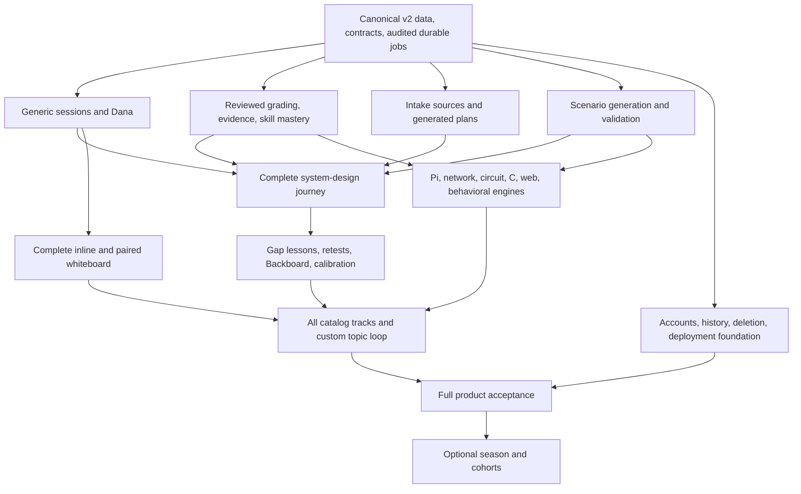

# PrepCrew: full product implementation roadmap

Baseline: the React/v2.3 integration and first learning loop were pushed in `9399673`. This roadmap covers the approved root `prototype.html`, `backend/sql/prepcrew.sql`, and the product brief. Implemented behavior and remaining acceptance gates are listed separately below.

## Product completion

A candidate can provide their goals and failed questions, receive a personalized plan across Hardware, Infra, Software, and Communication, run validated mixed-section tracks, talk naturally with Dana while working, inspect evidence-backed assessments, learn from a specific gap, and return to a different retest that changes their measured mastery. All 11 approved catalog tracks and the custom-topic flow must work before the full core product is complete.

The visual contract remains the approved prototype: light cards, indigo accent, dark terminal, skill circles, generation preview, session surfaces, evaluator fleet, evidence inspection, lessons, and retest reason tags. Memory has no dedicated UI.

## Current implementation inventory

| Area | Current state | Remaining work |
| --- | --- | --- |
| Vite/React/TypeScript UI | Intake, plan/circles, session/transcript, inline board, fleet with per-skill assessments, gap-derived lesson, pairing page exist. | Complete every surface and interaction in the prototype; replace remaining previews and fixed text with persisted product behavior. |
| Tiger Data/v2.3 | Migrations run; `session_events`, `skill_assessments`, `metrics`, `mastery_hourly`, `latency_1m` verified. | Clean-install/recovery coverage, deletion reconciliation, complete instrumentation, application queries for all features. |
| Intake | Role, company chips, struggles, failed question, optional link saved. | Resume/job/repo/document ingestion and extraction, failed-question classification, editable persisted profile and source provenance. |
| Plans | Rules select a domain; authored catalog cards and 23 skills are seeded. | Actual plan generation, priorities, prerequisites, versioning, custom topics, company/role target handling. |
| Generation | Audited session and lesson subjects, parent-linked checks, structured output, cached sample-board critique. Grading recovers after restart. | Durable execution for other generation subjects, generation UI, validators, scenario versions, cost/token usage where available. |
| Dana | Live Gemini and ElevenLabs; continuous microphone and playback; partial captions, interruption, mute, replay, typing. | Engine-independent interviewer, semantic pacing, utterance/reconnect reliability, field tests for background speech and echo. |
| Whiteboard | Live PNG critique, validated targets, computed geometry, animated separate annotations, persistence after reload. | Configurable pause review, complete edit/review lifecycle, robust interruption/replay, real iPad QR pairing and reconnect testing. |
| Grading | Versioned system-design practice criteria, exact quote/event/type/step checks, independent semantic/score review, per-skill scores, restart/retry and partial-result handling. | Human calibration, evaluators for every other engine, stronger quality acceptance corpus and complete legacy consolidation. |
| Learning loop | Verified-gap lesson generation and second-model review, new checked retest track/scenario, queue/focus/parent links, mastery comparison citations, Postgres opener memory. | Backboard, adaptive difficulty, generalization to other engines, human review and broader lifecycle acceptance. |
| Hands-on engines | Seeded engine definitions; legacy circuit module reads stored voltages. | Actual Linux/network simulation, DC solver, C/code execution harnesses, web repo runner, behavioral engine. |
| Deployment/accounts | Local development works. Browser-local user id; artifacts on local disk. | Account identity, authorization, durable storage/jobs, HTTPS, operations, export/deletion, CI, production deployment. |

Latest integration verification: 329 backend tests and 15 frontend tests passed, production build passed, migration `003_learning_loop` ran on Tiger Data, and the database invariant verifier passed with fixture writes rolled back. A controlled live Gemini/Tiger session-to-lesson-to-changed-retest check validated 11 supported claim references, updated mastery and comparison evidence. Abrupt API restart during grading recovered jobs; duplicate finish requests did not duplicate assessments; partial failure resumed only failed evaluators. Browser inspection verified lesson generation and retest start. Synthetic utterances test plumbing, not human grading quality. Three standalone browser E2E journeys now pass against a freshly migrated disposable Tiger Data schema, including reload, critique persistence, grading/evidence, sequence replay, idempotent strokes and stale-step rejection. No normal workspace records are fixtures. Human grading calibration remains pending in docs/GRADING_REVIEW.md.

## Architecture to finish around

- Retain Vite + React + TypeScript, FastAPI, Tiger Data/Postgres, Gemini, ElevenLabs, and Backboard. Hosting remains a deployment choice; Vultr is an option from the brief.
- Make `/api/v2` and the `prepcrew` v2.3 schema the canonical product path. Upstream memory, evaluators, and time-series changes currently serve legacy records/events and must be adapted before React benefits from them.
- Preserve legacy data during consolidation. Retire legacy product routes only after their useful behavior has been ported and compatibility requirements are understood.
- Use a shared track/session engine driven by persisted `scenario_steps`, with surface adapters for voice, board, STAR, terminal, editor, schematic, browser, and Pi visualization. The existing hard-coded three-step rate-limiter session becomes one scenario definition.
- Keep application evidence in the server event log. Store artifacts, scenario state, and model output separately with explicit provenance back to relevant events and generation jobs.
- The current grading worker runs with the API lifespan and uses persisted session status plus connection-held PostgreSQL advisory locks. This is the minimal local default; it needs no additional queue service. Generalize durable execution to generation, validation, extraction, lessons and memory synchronization. Select a separate worker/queue mechanism before adopting that architectural fork.
- Select the execution isolation strategy before implementing C and repo runners. Candidate code must have bounded CPU, memory, time, filesystem, and network access; application/provider secrets must be outside the execution environment.
- Select the account provider, hosting, artifact store, and deployment budget before public rollout. These decisions need concrete choices, rather than assumptions hidden in implementation.

## Build sequence and acceptance gates

### 1. Consolidate data, contracts, and provider auditing

Port useful legacy behavior into the canonical product path. Reconcile duplicate memory adapters, evaluator output shapes, event identifiers, configuration, migration instructions, and time-series reads. Preserve the required hourly mastery/minute latency aggregates rather than adopting the legacy daily aggregate as the v2 product contract.

Expand the generation wrapper beyond session-only subjects: plans, tracks, scenarios, extracted sources, lessons, openers, critiques, evaluations, and second-model checks. Each actual model attempt, including retries and failed/cancelled attempts, has an audit row. Implement durable job transitions and recovery. Use migrations for new tables/indexes/constraints.

**Gate:** a fresh database can migrate and seed; an existing database upgrades without data loss; generated frontend contracts match the API; every active product model call is auditable; restarting a worker does not strand a job or duplicate results.

### 2. Generalize the session and finish Dana's interaction model

Replace rate-limiter-specific step logic, prompts, and evaluator names with track/engine configuration. Define step entry, objective completion, hints, interruptions, pause/resume, manual overrides, finish, and replay. Preserve both sides of the conversation in the transcript.

Dana owns the interview agenda, supplies the scenario's requirements, answers direct questions, and advances based on completed objectives. Capture stays active during speech. Recognized candidate utterances cancel stale generation/playback. Distinguish silence, incomplete speech, speech noise, playback echo, and intentional interruption as far as the selected providers support; test the remaining limits with people.

**Gate:** an interview finishes naturally without repeated manual sends; a candidate can interrupt, ask for time, type, mute, and resume; duplicate or late messages cannot skip a step or replay an abandoned answer. Define and measure speech-end-to-first-audio latency as one end-to-end metric.

### 3. Complete trustworthy grading and mastery

Port reviewed rubric handling and deterministic quote validation into v2. Define criteria, score ranges, skill mappings, and evaluator selection for each engine. Parallel evaluators consume the same immutable session snapshot, candidate artifacts, and tool results.

The evidence checker must verify session ownership, sequence existence, actor, event type, exact quotes, and whether the cited material supports the proposed claim. Use deterministic checks for observable facts and an audited second model when interpretation needs semantic review. Keep the limitation visible: a second model is not a proof. Reject unknown skill ids instead of silently mapping them to system design.

Compute scores per supported criterion and skill. Missing evidence or an evaluator outage must not become a fabricated zero, gap, or diagnosis. Version the rubric and mastery policy; handle partial evaluator failure, retry, and late results without duplicate assessments. Refresh the plan/circles after grading and retests.

**Gate:** accepted claims have inspectable event evidence; unsupported claims are excluded from reports, mastery, lessons, and memory. A human-labeled test set checks false claims and inappropriate gaps. The fleet reflects live run states and real errors. Each skill changes only from evidence relevant to that skill.

### 4. Complete intake, source ingestion, and plan generation

Persist editable role, target companies, struggles, failed questions, and optional source material. Implement resume/job text or uploads and supported repo links, with extraction jobs and source provenance. Treat source text as data, never model instructions. Define supported formats and size limits.

Generate domain/skill mappings, prerequisites, priorities, recommended tracks, and explanations from that intake. Reuse the seeded taxonomy before creating user-scoped skills; avoid duplicates. Support custom topic creation, generation preview, add-to-plan, removal, regeneration, and plan history. Persist successful results so refresh/reconnect does not restart generation.

Resolve company targets by company and role. Keep seeded or inferred practice benchmarks labeled according to their source; avoid presenting them as verified hiring cutoffs. Empty/unassessed wedges stay empty until actual assessment evidence exists.

**Gate:** substantially different profiles produce different useful plans; every recommendation has a source or stated rationale; custom topics persist; the start card comes from the selected plan; every runnable card passes its engine's publication gate.

### 5. Build the reusable generation and validation pipeline

Implement `draft -> schema check -> engine validation -> rubric check -> ready`, plus failure, bounded regeneration, and cancellation. Persist engine/version, parameters, scenario, steps, validator results, model provenance, and cache keys. Cached content must match the inputs and relevant versions.

The three layers have different guarantees:

1. **Authored simulator:** known engine and fault specification reproduce the expected symptom and accept the reference fix.
2. **Model adaptation inside an engine:** generated parameters/spec pass the deterministic engine, compiler, solver, or fail-then-pass tests before publication.
3. **Conceptual drill:** schema/rubric checks plus a separate model review. Label the weaker semantic guarantee; do not imply that an execution engine proved the answer.

**Gate:** malformed, unsolvable, incorrectly seeded, or reference-failing scenarios never become runnable. Generation UI reflects actual job state. Failure preserves inputs and supports an explicit retry.

### 6. Complete lessons, retests, Backboard, and implicit adaptation

Create lessons only from supported gaps, with relevant citations, an explanation, worked example, practice task, and checked answer or rubric. Label generated content. Choose prerequisites when the evidence suggests a foundational gap.

Persist the retest queue and link each retest to its parent session, skill, supported gap, lesson, and changed constraints. Retest the same competency with a genuinely different task; compare relevant criteria rather than averaging unrelated evaluator scores.

Adapt the upstream Backboard client to v2 memory provenance. Store only appropriate verified findings, external identifiers, and deletion references. Implement timeout/failure fallback, deduplication, stale/conflicting-memory handling, and an idempotent synchronization/deletion path. The current root environment lacks a Backboard key.

Use memory only in Dana's opener, reason tags, plan/retest selection, and calibrated difficulty. Do not add a memory screen.

**Gate:** session A produces a supported gap; its lesson addresses that gap; retest B changes the task; relevant mastery updates; the next opener uses supported prior context. Backboard failure does not prevent practice, and deletion removes external memory too.

### 7. Complete whiteboard and paired-device support

Finish spoken questions and statements, `Done` versus configured `on_pause`, looking state, cached demo matching, and the revise/review lifecycle. Snapshot only candidate work; persist PNG/transcript/stroke references before vision. Validate every mark against candidate ids and derive geometry locally.

Handle interruptions during annotation speech/drawing, replay completion, overlapping look requests, late results, and changed boards. Implement actual QR pairing, one-time short-code redemption, paired-device identity, reconnect/resume, and expiry. Use the same authoritative event sequence across laptop/iPad.

**Gate:** real iPad Safari/Apple Pencil and laptop tests pass over HTTPS. Device reconnect does not duplicate strokes. Refresh restores both work and critique. Dana's marks never enter the candidate's graded artifact. Measure vision latency against the 2-4 second target and surface genuine failures honestly.

### 8. Implement every approved track and its engine

All tracks use the shared session, evidence, generation, grading, lesson, and retest infrastructure. Finish the common learning loop first; then build the Pi and STAR experiences as the next complete tracks, followed by the remaining engines. Keep incomplete catalog cards non-runnable.

| Domain / approved track | Engine and frontend work | Required validity and evidence |
| --- | --- | --- |
| **Infra: Fix the site on the Pi** | Deterministic Linux fault engine; dark terminal, config editor, request/browser panel, Pi view, hints, diagnostic tools and hardware replacement actions. Faults include proxy, permissions, storage, power/thermal conditions. Actions actually change simulator state. | Each seeded fault reproduces its symptom; a reference repair resolves it. Commands, edits, diagnostic outputs, part changes, hints, and measured request behavior are events. Grade process as well as final repair. |
| **Infra: Networking: a slow request** | Network path engine for DNS, TCP, proxy and app hops; consistent simulated tool outputs; generated scenario variants. | Validate the planted fault and latency profile. Evidence identifies the tests used to isolate the failing hop. Clearly identify simulation results. |
| **Hardware: Circuit debugging** | Actual DC solver, editable schematic, probes, component/fault state, and diagram explanation. Replace legacy stored voltage lookup. | Healthy/faulted netlists solve; planted faults reproduce expected readings; reference repairs restore the circuit. Probe and schematic-edit events support claims. Explicitly bound the solver's supported components and analyses. |
| **Hardware: Embedded C: read and debug** | Editor/review surface, seeded bug variants, compiler/static checks and appropriate deterministic harnesses. | Validate the bug and reference fix against the stated model. Do not claim a host harness proves all ISR or hardware-concurrency behavior. Cite code snapshots, tests, and spoken explanation. |
| **Hardware: Embedded C: write low-level code** | Sandboxed compiler/tests, register/task models, code versions, run output and spoken reasoning. | Reference solution passes defined tests; candidate tests run within limits. Grade masks/shifts, access semantics, edge cases, and explanation with evidence. |
| **Software: Web dev: fix a failing feature** | Isolated repo runner, terminal, editor, browser preview, failing tests, reference repair, and bounded workspace state. Include endpoint-building tasks as validated variants where relevant. | Tests fail on the broken version and pass on the reference repair. Candidate modifications/test results are logged; isolation and resource limits hold. |
| **Software: LeetCode: explain as you solve** | Conceptual reasoning drill with code/editor where configured, examples, complexity discussion, follow-ups and variants. | Second-model rubric review for conceptual tasks; deterministic tests when execution is offered. Distinguish method/communication claims from executable correctness. |
| **Software: System design: whiteboard** | Generalize the existing rate-limiter flow into generated prompts, constraints, rubrics, board review, and trade-off interviews. | Separate model checks prompt/rubric coverage; board targets validate; claims cite candidate speech/strokes. No claim that architecture correctness was deterministically proven. |
| **Communication: Behavioral STAR** | Story choice, live STAR guide, spoken narrative, follow-up, and evidence-backed coaching. | Review prompt/rubric; map detected S/T/A/R content to actual transcript events. Missing metrics prompt clarification rather than invented impact. |
| **Communication: Conflict and feedback** | Scenario variations and follow-ups about actions, ownership, feedback, and outcomes. | Reviewed conceptual rubric; exact candidate evidence for every reported strength/gap. |
| **Communication: Build your story bank** | Extract candidate-provided projects/stories, let the user correct them, store tags and competencies, select different stories for retests. | Preserve source-document/session references; never fabricate experience, first-person actions, or quantified results. |
| **Custom topic** | Persist user-scoped skill, conceptual drill generation, review, add-to-plan and retest. | Same conceptual validation/publication gate; unsupported hands-on tasks remain unavailable until an appropriate engine exists. |

The Pi visualization must reflect simulator state. Building a decorative 3D board alone does not complete the Pi track. Likewise, an editor alone does not complete a coding track.

### 9. Complete account, workspace, history, and privacy flows

Replace browser-local identity with authenticated ownership. Add workspace retrieval across devices, saved plan/session history, resume/replay, source management, profile/preferences, export, and consent-aware deletion. Secure HTTP, voice/event sockets, pairing, artifacts, and job endpoints consistently.

Reconcile deletion semantics across the v2 SQL function, assessments, aggregate charts, source documents, artifacts, jobs, and external Backboard memories. The current SQL retains assessments while unlinking their evidence; decide and implement an explicit policy so retained mastery is not misleadingly presented as still inspectable session evidence.

**Gate:** two users cannot read or mutate each other's material; users can find past sessions and continue on another device; a deletion removes the intended content and external artifacts, and retained aggregates behave according to the stated policy.

### 10. Ship and operate the complete app

Set up reproducible builds, migration deployment, HTTPS, websocket proxying, durable artifact storage, job workers, health/readiness checks, secret configuration, resource budgets, provider concurrency/backoff, and observability. Instrument speech/vision/evaluation latencies, real token/cost data where available, failed jobs, queue time, and per-skill mastery. Display live data from the required Tiger aggregates.

Add CI for backend/frontend tests, type/build checks, migration/invariant checks, contracts, and browser journeys. Exercise a separate test database and supported browsers/devices. Define backup/restore and rollback procedures; run a clean deployment and recovery rehearsal.

**Gate:** the hosted app completes each supported journey, preserves work across restart/failure, has meaningful error recovery, supports user deletion, and exposes measured operational status. Hosting is complete only after deployed HTTP, voice sockets, iPad pairing, jobs, storage, and database behavior are verified together.

### 11. Optional prototype/schema extensions

The schema labels the season tracker and school cohort view optional. After core completion, implement application stages/notes and cohort membership/roles with aggregate-only instructor views. Make these explicit scope additions; do not silently equate a completed core learning loop with implementation of these optional tables.

**Gate:** application changes persist; instructors see authorized aggregates without transcripts; empty/small-cohort behavior and privacy rules are defined and tested.

## Dependency chart

Account/deployment preparation can proceed alongside the learning loop. Public rollout depends on its authorization, privacy, and recovery gates. Coding-track work depends on selecting execution isolation before exposing any runner.

## End-to-end acceptance matrix

| Journey | Required proof |
| --- | --- |
| New candidate | Intake/source -> generated plan -> valid track -> completed session -> evidence-checked report. |
| Learning loop | Supported gap -> relevant lesson -> changed retest -> same-skill assessment -> refreshed circle and next-session opener. |
| Voice and board | Talk while drawing -> immediate question reply -> Done/pause -> genuine looking state -> valid vision marks -> interrupted/replayed speech -> saved replay. |
| Hands-on tracks | Actual simulated/tool/code action -> consistent state/output -> verified outcome -> process/technical assessment -> targeted retest. Run for every published engine. |
| Custom topic | New topic -> reviewed conceptual drill -> saved plan -> session -> learning loop; no false engine guarantee. |
| Persistence | Refresh, reconnect, API/worker restart, and device switch preserve committed work and resume without duplicate events/results. |
| Failures | Provider quota, invalid JSON, timeout, missing evidence, unknown annotation target, evaluator partial failure, sandbox failure, and Backboard outage recover honestly. |
| Ownership/deletion | Cross-user access denied; expired/reused pair codes rejected; deletion handles local and external data and updates the stated mastery policy. |
| Operations | Fresh migration, upgrade, deployment, backup/restore, real aggregate readouts, measured provider latency and bounded spend. |

Run deterministic tests and browser E2E in isolation, then a small controlled live-provider acceptance suite. Include human review of grading and natural conversation; synthetic fixtures alone cannot establish their quality. Label recorded critiques and synthetic evaluation demonstrations. A live model is not required to hallucinate a rejected claim during a demo: use a clearly labeled test proposal to demonstrate rejection.

## Immediate next work package

The first system-design learning-loop slice is implemented: criterion-to-skill assessment, rejection of unknown skills, independent evidence review, recoverable grading, and gap -> checked lesson -> changed retest -> updated circle. Practice rubrics are authored and model-reviewed, not human-calibrated. Full backend consolidation and additional generation workflows remain open. Lesson generation now uses a persisted, bounded work queue with independent per-call model audits.

1. Browser E2E isolation and three acceptance journeys are implemented and verified. Human rubric review remains pending; synthetic examples and a review procedure are in docs/GRADING_REVIEW.md.
2. Persisted generic session steps, configurable pacing, pause/resume, hints and scenario-specific evaluator selection are implemented. Three browser journeys verify the original board flow plus a synthetic two-step behavioral fixture with its own fleet. Other production tracks still require reviewed content, adapters and publication gates.
3. Durable lesson generation and saved progress/retry/cancel UI are implemented. Queue acceptance verifies idempotence, worker exclusion, restart recovery, atomic publication and bounded retries on an isolated Tiger schema with recorded fixtures. Source ingestion now supports text/PDF/Markdown and public GitHub README imports, durable excerpt extraction, exact-quote validation, user confirmation and persisted intake attachments. Five isolated browser journeys cover the source flow and personalized plan jobs. Gemini now ranks all catalog tracks and generates a rate-limiter scenario from intake/sources; an independent review and local validity checks gate publication. Prior plans remain available until a new version publishes atomically; intake creates no ability scores. One controlled live plan/review run passed. Additional conceptual topics, custom-topic generation and the remaining engine adapters still need implementation.
4. Connect Backboard to verified provenance, resolution and deletion; implement difficulty calibration.
5. Implement the remaining tracks using those interfaces, starting with Pi and STAR; complete device and deployment gates where dependencies allow.

This sequence establishes the common product loop before multiplying unfinished implementations across the catalog. Full implementation still includes every catalog engine, account/device path, and release gate above.
